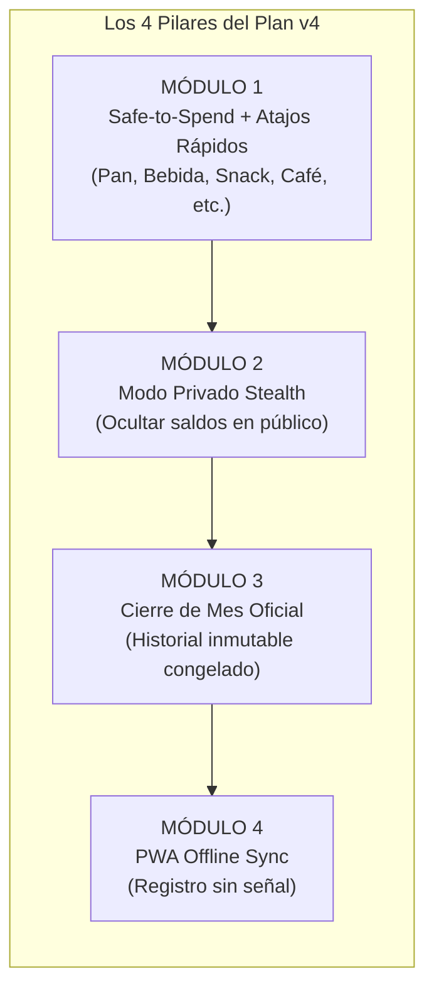
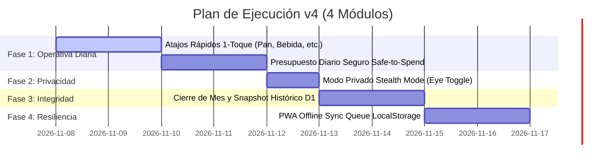

# 🚀 Plan de Mejoras v4 (Revisado) — FinanzApp: Consola Financiera Inteligente

> **Auditoría y Hoja de Ruta Depurada de Capacidades Esenciales ("Must-Have")**  
> **Fecha:** Noviembre 2026  
> **Versión:** 4.1.0 (Enfoque de Alta Adopción y Foco Operativo)  
> **Filosofía de Arquitectura:** 100% Inversión $0 (Serverless Cloudflare D1 + Workers + Universal Expo 52) · Tesla Minimalist + iOS Liquid Glass

---

## 📑 Tabla de Contenidos

1. [Alcance y Cambios del Plan Depurado](#1-alcance-y-cambios-del-plan-depurado)
2. [Los 4 Módulos Esenciales ("Must-Have Innegociables")](#2-los-4-módulos-esenciales-must-have-innegociables)
   - [Módulo 1: Presupuesto Diario Dinámico ("Safe-to-Spend") & Catálogo de Atajos Rápidos Configurables](#módulo-1-presupuesto-diario-dinámico-safe-to-spend--catálogo-de-atajos-rápidos-configurables)
   - [Módulo 2: Modo Privado / Ocultar Montos en Transporte Público (Camouflage Mode)](#módulo-2-modo-privado--ocultar-montos-en-transporte-público-camouflage-mode)
   - [Módulo 3: Cierre de Mes Oficial y Snapshot Histórico Congelado](#módulo-3-cierre-de-mes-oficial-y-snapshot-histórico-congelado)
   - [Módulo 4: PWA Offline-First con Cola de Sincronización Automática](#módulo-4-pwa-offline-first-con-cola-de-sincronización-automática)
3. [Catálogo Extendido de Atajos de 1 Toque (Día a Día en Chile)](#3-catálogo-extendido-de-atajos-de-1-toque-día-a-día-en-chile)
4. [Cronograma y Fases de Ejecución](#4-cronograma-y-fases-de-ejecución)

---

## 1. Alcance y Cambios del Plan Depurado

Siguiendo tus indicaciones, se eliminaron los módulos que agregaban sobrecarga analítica o de negociación ajena al uso personal cotidiano:
- ❌ **Eliminado Módulo 2 anterior (Topes por Categoría):** Reemplazado por el enfoque más intuitivo y libre del **Presupuesto Diario Seguro (*Safe-to-Spend*)**, evitando la rigidez burocrática de fijar límites por rubro.
- ❌ **Eliminado Módulo 4 anterior (Simulador de Amortización y Prepago):** Se mantiene el tracking de cuotas existente en tarjetas y fijos sin complejizar la app con fórmulas bancarias avanzadas.
- ❌ **Eliminado Módulo 5 anterior (Split de Pareja):** Se preserva la vinculación existente de cuentas de ahorro conjuntas, postergando la división granular de boletas.
- ❌ **Eliminado Módulo 6 anterior (Smart Paste de Bancos):** Se prioriza la captura ultra-rápida nativa de **1 toque con botones configurables**, que es más inmediata que copiar y pegar correos.

---

## 2. Los 4 Módulos Esenciales ("Must-Have Innegociables")

### Módulo 1: Presupuesto Diario Dinámico ("Safe-to-Spend") & Catálogo de Atajos Rápidos Configurables `[COMPLETADO]`

#### Objetivo
Resolver la fricción número 1 del usuario: saber con exactitud matemática **cuánta plata puede gastar hoy** sin descalzar sus cuentas fijas, y permitir registrar los micro-gastos cotidianos chilenos con **montos predeterminados por categoría pero 100% editables al vuelo**, reconociendo que los precios en la calle nunca son fijos (ej. una bebida puede costar \$1.200, \$1.500 o \$1.800 según el local).

#### 1. Cálculo en Tiempo Real del "Safe-to-Spend"
$$\text{Margen Operativo Disponible} = \text{Ingresos Fijos} - \text{Fijos No Pagados} - \text{Cuotas de Tarjetas del Mes} - \text{Gastos Variables Acumulados}$$
$$\text{Presupuesto Diario Seguro} = \frac{\max(0, \text{Margen Operativo Disponible})}{\text{Días Calendario Restantes del Mes}}$$

* **Visualización:** Tarjeta Liquid Glass destacada en la cabecera del módulo Billetera:
  - *Monto diario disponible hoy* (ej. **\$12.450 / día**).
  - *Semáforo de ritmo:* Si hoy gastas menos, el saldo no gastado se acumula automáticamente aumentando tu presupuesto de los días siguientes o tu ahorro mensual.

#### 2. Mecanismo de Registro Ágil con Monto Editable al Momento del Gasto
Para que registrar no tome más de 2 segundos pero permita ajustar el precio real de compra:
1. **Tap en el Atajo (ej. 🥤 Bebida / Jugo):**
   - Despliega un **Mini-Sheet Ágil Liquid Glass** con el título ya fijado (*"Bebida / Jugo"*), la categoría predeterminada (*Bebidas*), y la cuenta de débito principal pre-seleccionada.
   - **Monto Pre-rellenado y Enfocado:** Viene con el valor por defecto (`$1.500`) listo.
   - **Confirmación Rápida:** Si costó exactamente `$1.500`, basta con pulsar **"Registrar Gasto"** (1 toque, 0.5s).
   - **Edición Inmediata de Precio:** Si costó otro valor (ej. `$1.800` o `$2.200`), el teclado numérico ya está activo para tipear la cifra real al instante, o pulsar botones rápidos de ajuste (`+$500`, `-$200`, `+$1.000`).
   - **Opción de Actualización:** Switch opcional *"Recordar este monto como mi nuevo valor predeterminado"*.
2. **Configurador del Catálogo (Configurar Atajos):**
   - Modal para editar los montos base permanentes de cada botón, ocultar atajos que no se usen o agregar nuevos botones personalizados (ej. *"Carga Bip $5.000"* o *"Feria Verduras $12.000"*).
   - Persistencia local en `AsyncStorage` / `localStorage`.

---

### Módulo 2: Modo Privado / Ocultar Montos en Transporte Público (Camouflage Mode) `[COMPLETADO]`

#### Objetivo
Permitir al usuario abrir y operar FinanzApp en el metro, micros, cafeterías o frente a compañeros de trabajo sin revelar sus ingresos, deudas o patrimonio consolidado.

#### Especificación Implementada
- **Botón Toggle en Cabecera:** Botón Liquid Glass interactivo `PrivacyToggleButton` con iconos vectoriales `Eye` / `EyeOff` al lado del selector de período en `DashboardScreen`, `FinancialTipsSection` y en la barra lateral de navegación (`AdaptiveNavigation`).
- **Efecto Visual:** Los valores numéricos en CLP se reemplazan global e instantáneamente por una máscara de privacidad (`$ ••••••`).
- **Persistencia:** Guarda la preferencia de privacidad en el dispositivo bajo la clave `@finanzapp_privacy_mode_v1` (`SecureStore` en móvil nativo y `localStorage` en web).
- **Contexto Operativo Intacto:** Se mantienen 100% legibles los porcentajes (ej. *64% de rigidez fija*, *6% uso de cupo*), indicadores de avance, fechas de corte, categorías y badges de salud financiera (`70/100`).

---

### Módulo 3: Cierre de Mes Oficial y Snapshot Histórico Congelado

#### Objetivo
Garantizar la inmutabilidad histórica. Los meses pasados deben quedar como "libros contables cerrados" que reflejen fielmente cómo terminó ese mes, sin alterarse si posteriormente se modifican cuentas o sueldos futuros.

#### Especificación
1. **Ceremonia de Fin de Mes:** Al llegar el último día del mes (o primeros días del siguiente), una tarjeta de confirmación permite realizar el "Cierre de Mes".
2. **Snapshot Inmutable en Base de Datos (Cloudflare D1):** Guarda un registro JSON inalterable con:
   - Patrimonio neto consolidado de cierre.
   - Total ingresos y gastos reales.
   - Tasa de ahorro lograda y score de salud financiera.
3. **Pestaña de Histórico:** Selector rápido para consultar cualquier mes anterior en modo sólo lectura verificado.

---

### Módulo 4: PWA Offline-First con Cola de Sincronización Automática

#### Objetivo
Que la aplicación nunca se quede congelada ni arroje errores de red al ingresar un gasto en subterráneos, estacionamientos o zonas sin señal 4G/5G en Chile.

#### Especificación
1. **Cola Local de Mutaciones (`localStorage Queue`):** Si el teléfono no tiene conexión a internet, el gasto se guarda inmediatamente en la cola local con un UUID generado en el cliente y el saldo local se actualiza de forma optimista.
2. **Auto-Sincronización Silenciosa:** Al reconectarse (`window.addEventListener('online')`), FinanzApp vacía la cola enviando las peticiones pendientes al backend en Cloudflare Workers y actualiza el estado sin requerir intervención del usuario.

---

## 3. Catálogo Extendido de Atajos de 1 Toque (Día a Día en Chile)

El catálogo incluirá botones predefinidos para la realidad chilena, y además una modal para que el usuario pueda **personalizar sus propios montos, nombres e iconos**:

| Atajo Rápido | Icono Vectorial | Monto Sugerido CLP | Categoría Asignada |
| :--- | :---: | :---: | :--- |
| **🥖 Pan Diario** | `Croissant` / `Utensils` | **\$2.000** | Alimentación |
| **🥤 Bebida / Jugo** | `CupSoda` / `Coffee` | **\$1.500** | Bebidas |
| **🍫 Snack / Kiosko** | `Cookie` / `Sparkles` | **\$1.200** | Alimentación |
| **☕ Café / Desayuno** | `Coffee` | **\$2.500** | Bebidas |
| **🚇 Metro / Micro Bip!** | `Bus` / `Train` | **\$840** | Transporte |
| **🍽️ Almuerzo Menú / Colación** | `UtensilsCrossed` | **\$6.500** | Alimentación |
| **🛒 Supermercado Rápido** | `ShoppingCart` | **\$15.000** | Alimentación |
| **💊 Farmacia / Urgencia** | `Pill` / `HeartPulse` | **\$8.000** | Salud |
| **🚗 Estacionamiento / Peaje** | `Car` / `Tag` | **\$2.500** | Transporte |
| **➕ Crear Atajo Personalizado** | `Plus` | *(Libre)* | *(Cualquiera)* |

> **Personalización:** Al mantener presionado cualquier botón o pulsar `Configurar Atajos`, el usuario puede cambiar el monto por defecto (ej. si su panadería cobra \$2.500 en lugar de \$2.000) o crear un atajo con su gasto recurrente favorito (ej. *"Carga Bip \$5.000"* o *"Cigarrillos \$4.800"*).

---

## 4. Cronograma y Fases de Ejecución

### Plan Inmediato de Inicio
Recomendamos comenzar hoy con la **Fase 1**:
1. Implementar la barra interactiva de **Atajos Rápidos de 1 Toque** en `WalletSection.tsx` con el catálogo chileno (Pan, Bebida, Snack, Café, Metro, etc.) y persistencia de configuración.
2. Implementar la tarjeta métrica de **Presupuesto Diario Seguro (*Safe-to-Spend*)** en tiempo real.
