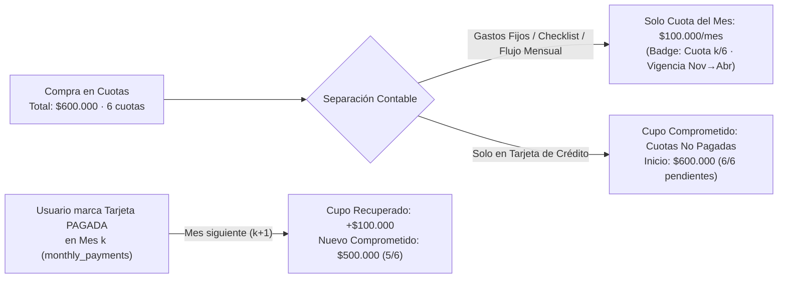

# 🚀 Plan de Mejoras v4.5 (`v45`) — FinanzApp: Cuotas Reales en Tarjetas, Recuperación de Cupo y Categorías Unificadas

> **Refinamiento de Precisión Contable en Tarjetas de Crédito y Consistencia Taxonómica**  
> **Fecha:** Noviembre 2026  
> **Versión:** 4.5.0  
> **Estado:** Propuesto (Pendiente de aprobación para intervención de código según `AGENTS.md` §3.1)  
> **Filosofía de Arquitectura:** 100% Inversión \$0 (Cloudflare D1 + Workers + Expo 52 Universal) · Tesla Minimalist + iOS Liquid Glass

---

## 📑 Tabla de Contenidos

1. [Resumen Ejecutivo y Objetivos](#1-resumen-ejecutivo-y-objetivos)
2. [Auditoría Previa de Dependencias (`FEATURES.md`)](#2-auditoría-previa-de-dependencias-featuresmd)
3. [Mejora 1: Compras en Cuotas en Tarjetas — Cuota Mensual en Fijos, Compromiso Total Solo en Tarjeta y Recuperación Progresiva del Cupo](#3-mejora-1-compras-en-cuotas-en-tarjetas--cuota-mensual-en-fijos-compromiso-total-solo-en-tarjeta-y-recuperación-progresiva-del-cupo)
   - [3.1 Diagnóstico del Comportamiento Actual](#31-diagnóstico-del-comportamiento-actual)
   - [3.2 Nuevo Modelo Contable: Cuota Mensual vs. Capital Comprometido](#32-nuevo-modelo-contable-cuota-mensual-vs-capital-comprometido)
   - [3.3 Esquema de Base de Datos y API (`backend/`)](#33-esquema-de-base-de-datos-y-api-backend)
   - [3.4 Flujo en UI: Ingreso en Tarjetas vs. Despliegue en Gastos Fijos](#34-flujo-en-ui-ingreso-en-tarjetas-vs-despliegue-en-gastos-fijos)
   - [3.5 Mecánica de Recuperación Progresiva de Cupo al Marcar como Pagado](#35-mecánica-de-recuperación-progresiva-de-cupo-al-marcar-como-pagado)
4. [Mejora 2: Unificación de Categorías entre Tarjetas de Crédito y Gastos Variables del Mes](#4-mejora-2-unificación-de-categorías-entre-tarjetas-de-crédito-y-gastos-variables-del-mes)
   - [4.1 Diagnóstico de Divergencia Actual](#41-diagnóstico-de-divergencia-actual)
   - [4.2 Fuente Única de Verdad (`SHARED_EXPENSE_CATEGORIES`)](#42-fuente-única-de-verdad-shared_expense_categories)
   - [4.3 Compatibilidad Retroactiva con Cargos Existentes](#43-compatibilidad-retroactiva-con-cargos-existentes)
5. [Matriz de Impacto Colateral en `FEATURES.md` (Regla 3.1)](#5-matriz-de-impacto-colateral-en-featuresmd-regla-31)
6. [Plan de Ejecución por Fases y Criterios de Verificación](#6-plan-de-ejecución-por-fases-y-criterios-de-verificación)

---

## 1. Resumen Ejecutivo y Objetivos

Este plan aborda dos fricciones operativas detectadas en el uso cotidiano de las tarjetas de crédito dentro de FinanzApp:

1. **Precisión contable de compras en cuotas y cupo bancario real:**
   - Al registrar una compra en cuotas con tarjeta de crédito (ej. \$600.000 en 6 cuotas), el usuario debe ver **el valor de la cuota mensual** (\$100.000/mes) en los gastos fijos / facturación mensual de la tarjeta y **nunca el total de la compra** (\$600.000) inflando los egresos del mes.
   - El **monto total comprometido de la compra** (y el saldo pendiente en cuotas futuras) debe quedar evidenciado **únicamente dentro de la tarjeta de crédito** (ocupando su cupo disponible real).
   - A medida que el usuario marca como **PAGADO** el estado de cuenta de la tarjeta cada mes en el checklist, al avanzar al mes siguiente (y de inmediato en el indicador de progreso de la tarjeta) se debe reflejar la **recuperación progresiva del cupo** (\$100.000 recuperados tras la cuota 1, \$200.000 tras la cuota 2, etc.).
2. **Paridad exacta de categorías entre Tarjetas y Gastos Variables:**
   - Los gastos registrados en las tarjetas de crédito deben compartir **exactamente las mismas categorías** (claves, nombres legibles, colores e iconos) que los **Gastos Variables del Mes** (`WalletSection`).

---

## 2. Auditoría Previa de Dependencias (`FEATURES.md`)

En cumplimiento de la regla de **Consulta Previa Obligatoria** (`AGENTS.md`), se identificaron las funcionalidades registradas actualmente vinculadas a estos dos requerimientos:

| ID en `FEATURES.md` | Módulo / Archivos Clave | Vínculo con Plan v4.5 |
| :--- | :--- | :--- |
| `[feat-cards-charges-and-installments]` | `src/components/finance/CreditCardsSection.tsx`, `src/lib/api.ts` | Alta/edición de compras en cuotas, selector de categorías de cargos en tarjeta. |
| `[feat-cards-quota-and-billing-alerts]` | `src/lib/finance.ts` (`calculateCreditCardMetrics`), `src/components/finance/CreditCardsSection.tsx` | Cálculo de `usedAmount`, `availableCredit`, `usagePercent` y visualización de recuperación de cupo. |
| `[feat-cards-3d-wallet-bento-showcase]` | `src/components/finance/CreditCardsSection.tsx` | Hero de cupo disponible, Tarjetero 3D y widgets Bento de *Facturado del Mes* vs *Cupo Comprometido*. |
| `[feat-fixed-monthly-checklist]` | `src/components/finance/FixedItemsSection.tsx`, `src/app/(main)/dashboard.tsx`, `backend/src/index.ts` | Despliegue del valor de cuota en fijos de tarjeta y evento `POST /monthly-payments/toggle` (`credit_card`) que gatilla la liberación de cupo. |
| `[feat-wallet-variable-expenses]` | `src/components/finance/WalletSection.tsx` (`VARIABLE_QUICK_CATEGORIES`) | Fuente de las categorías que deben replicarse en tarjetas de crédito. |
| `[feat-summary-category-distribution]` | `src/lib/finance.ts` (`CATEGORY_LABELS`, `CATEGORY_COLORS`), `src/components/finance/ExecutiveSummarySection.tsx` | Agregación cromática y etiquetas consistentes para categorías unificadas. |
| `[feat-dashboard-period-navigation]` | `src/lib/finance.ts` (`calculateProjectedPosition`) | Cálculo de `creditCardsDebt` y coherencia patrimonial al navegar entre meses. |
| `[feat-future-purchases-viability]` | `src/components/finance/FuturePurchasesSection.tsx` (`handleMarkAsPurchased`) | Conversión en 1 toque ("Lo Compré") a cuotas en tarjeta y mapeo de categorías. |
| `[feat-intelligence-diagnostic-engine]` & `[feat-finanzai-query-engine]` | `src/lib/intelligence.ts`, `src/lib/queryEngine.ts` | Consumidores de `calculateCreditCardMetrics` y auditorías de categorías/cupo. |

---

## 3. Mejora 1: Compras en Cuotas en Tarjetas — Cuota Mensual en Fijos, Compromiso Total Solo en Tarjeta y Recuperación Progresiva del Cupo

### 3.1 Diagnóstico del Comportamiento Actual

Al inspeccionar el código vigente (`src/components/finance/CreditCardsSection.tsx`, `src/components/finance/FixedItemsSection.tsx` y `src/lib/finance.ts`):

1. **Ambigüedad en el ingreso de cuotas (`CreditCardsSection.tsx`):**
   - El formulario actual solo solicita `"Monto Mensual CLP"` y luego un selector de plazo (`1, 3, 6, 12, 24 cuotas` o `Permanente`) que únicamente calcula `end_date = shiftPeriod(start_date, months - 1)`.
   - No existe un modo explícito de **"Compra en Cuotas"** donde el usuario ingrese el **Total de la Compra** (ej. \$600.000 en 6 cuotas) para que el sistema derive automáticamente la cuota (\$100.000/mes) y conserve el total original para el control de cupo.
2. **Desacople entre cupo bloqueado y pagos mensuales (`calculateCreditCardMetrics` en `src/lib/finance.ts`):**
   - Hoy `calculateCreditCardMetrics(card, cardRecurringExpenses, period)` calcula:
     $$\text{usedAmount} = \text{baseBalance} + \sum_{\text{activos en } period} \text{item.amount}$$
   - Esto produce dos distorsiones críticas en compras en cuotas:
     - **Si el usuario ingresa la cuota (\$100.000):** El cupo disponible solo descuenta \$100.000 en vez de los \$600.000 reales comprometidos con el banco, y al marcar como pagado en `monthly_payments` el cupo no muestra ninguna recuperación al mes siguiente.
     - **Si el usuario ingresa el total (\$600.000):** El checklist de `FixedItemsSection.tsx` y el resumen mensual despliegan \$600.000 como gasto fijo del mes en vez de \$100.000.
3. **`CreditCardsSection.tsx` desconoce los pagos del checklist (`monthly_payments`):**
   - `DashboardScreen` pasa `paidCardIdsInPeriod` a `FixedItemsSection`, pero no pasa `payments` (`MonthlyPayment[]`) a `CreditCardsSection` ni a `calculateCreditCardMetrics`.

### 3.2 Nuevo Modelo Contable: Cuota Mensual vs. Capital Comprometido

Se establecen tres invariantes matemáticas estrictas:

1. **Valor de Cuota en `recurring_items.amount`:**
   - Para toda compra en cuotas ($N \ge 2$ o $1$ cuota), `recurring_items.amount` almacena siempre el **valor de la cuota mensual**:
     $$\text{cuotaMensual} = \text{round}\left(\frac{\text{totalCompra}}{N}\right)$$
   - De este modo, **todos los resúmenes de flujo de caja, gastos fijos y el estado de cuenta mensual a pagar** suman únicamente la cuota del mes (\$100.000), nunca el total de la compra (\$600.000).
2. **Capital Total Comprometido (Visible solo en la Tarjeta):**
   - Para una compra en cuotas con rango $[start\_date, end\_date]$ ($N$ meses) y cuota $c$, el total comprometido en un período de consulta $P$ corresponde a la suma de **todas las cuotas aún no pagadas** de esa compra hasta $end\_date$:
     $$\text{capitalPendiente}(P) = \sum_{m = \min(start\_date, P)}^{end\_date} \mathbb{I}\big[\text{cuota del mes } m \text{ no pagada}\big] \times c$$
   - En la práctica:
     - Se evalúa mes a mes desde `start_date` hasta `end_date` si el mes $m$ está marcado como pagado (`is_paid === true` en `monthly_payments` para `target_type = 'credit_card'` con `target_id = card.id` — o `target_type = 'recurring_item'` con `target_id = item.id`).
     - Las cuotas de meses con `is_paid === true` se consideran **liquidadas / cupo liberado**.
     - Las cuotas del mes actual $P$ (si aún no está pagado), meses futuros ($> P$) hasta `end_date`, y cualquier cuota pasada ($< P$) **no pagada** siguen ocupando cupo de la tarjeta.
   - Para cargos recurrentes continuos/permanentes (sin `end_date` ni cuotas finitas, ej. Netflix, suscripciones), ocupan cupo únicamente por su cargo mensual del mes activo (`item.amount`) si el mes no ha sido pagado (o según el criterio mensual estándar).
3. **Separación visual en Tarjeta vs. Gastos Fijos:**
   - **En `FixedItemsSection.tsx` (Gastos Fijos):**
     - La fila de la tarjeta muestra como monto a pagar del mes: `baseBalance + suma de cuotas/cargos del mes` (ej. \$100.000).
     - El desglose de ítems de tarjeta muestra `Nombre · Cuota 1/6 · $100.000` (el valor de la cuota, jamás los \$600.000 totales).
   - **En `CreditCardsSection.tsx` (Tarjetas de Crédito):**
     - El **Cupo Utilizado** y el **Cupo Disponible** reflejan el compromiso total real en cuotas pendientes (\$600.000 antes del primer pago).
     - Se diferencia claramente en dos métricas dentro de la tarjeta:
       - **Facturado a pagar este mes:** \$100.000 (cuota del período).
       - **Deuda total en cuotas (solo tarjeta):** \$600.000 $\rightarrow$ \$500.000 $\rightarrow$ \$400.000...
       - **Cupo recuperado por cuotas pagadas:** +\$100.000 (1/6 pagadas).

### 3.3 Esquema de Base de Datos y API (`backend/`)

Se propone extender `recurring_items` de forma **100% retrocompatible** (valores `NULL` para ítems ya existentes o suscripciones continuas):

1. **`backend/src/db/schema.sql` & migración segura en `backend/src/index.ts` (`ensureRecurringInstallmentColumns`):**
   - `installments_count INTEGER` — Cantidad total de cuotas (`NULL` si es recurrente continuo/permanente, `>= 1` si es compra en cuotas).
   - `total_purchase_amount INTEGER` — Monto total original de la compra (`NULL` si es recurrente continuo).
2. **Endpoints afectados en `backend/src/index.ts`:**
   - `POST /recurring-items` y `PUT /recurring-items/:id`: aceptar y persistir opcionalmente `installments_count` y `total_purchase_amount`.
   - `GET /recurring-items`: retornar ambos campos en cada `RecurringItem`.
3. **Tipos en `src/lib/api.ts`:**
   - Agregar `installments_count?: number | null` y `total_purchase_amount?: number | null` a `RecurringItem`, `CreateRecurringItemInput` y `UpdateRecurringItemInput`.

> **Nota de compatibilidad:** Si un registro legacy en tarjeta tiene `end_date` definido pero `installments_count` es `NULL` (cargos antiguos creados con los presets `3/6/12/24 Cuotas`), el motor inferirá $N = \text{diffPeriodsInMonths}(start\_date, end\_date) + 1$ y $\text{total} = \text{amount} \times N$, de modo que también puedan mostrar progreso `Cuota k/N` si el usuario los edita o consulta.

### 3.4 Flujo en UI: Ingreso en Tarjetas vs. Despliegue en Gastos Fijos

#### A. Formulario de Nuevo Cargo / Edición en `CreditCardsSection.tsx`
1. **Selector de Tipo de Cargo en Tarjeta (Segmented Control):**
   - `💳 Compra en Cuotas` (con presets `1, 3, 6, 12, 24` o número personalizado de cuotas).
   - `🔄 Suscripción / Recurrente` (cargo fijo mensual continuo sin fecha de término o por período).
2. **Campos al elegir `Compra en Cuotas`:**
   - **Input principal:** *"Monto Total de la Compra (CLP)"* (ej. `600000`) + toggle opcional *"Ingresar valor por cuota"* para casos con interés bancario donde la cuota no sea división exacta.
   - **Cálculo en tiempo real (Card de Vista Previa):**
     - Muestra destacado: **`6 cuotas de $100.000/mes`** · Vigencia `Nov 2026 → Abr 2027`.
     - Subtítulo explicativo: *"En Gastos Fijos aparecerá solo la cuota de $100.000/mes. Los $600.000 ocuparán cupo en esta tarjeta y se irán liberando al marcar pagado cada mes."*
   - Al guardar, envía `amount: 100000`, `installments_count: 6`, `total_purchase_amount: 600000`, `start_date`, `end_date`.
3. **Conversión desde `FuturePurchasesSection.tsx` ("Lo Compré en Cuotas"):**
   - `handleMarkAsPurchased` en modo `'installments'` enviará también `installments_count: n` y `total_purchase_amount: item.amount` junto con `amount: monthlyQuota`.

#### B. Despliegue en la Tarjeta de Crédito (`CreditCardsSection.tsx`)
- En el **Widget Bento "Facturado del Mes"** vs **"Deuda Total en Tarjetas"**:
  - Mostrar claramente **Facturado Mes (`$100.000`)** (lo que se paga este mes) y **Cupo Comprometido Total (`$600.000` / pendiente en cuotas)**.
- En cada tarjeta de la lista de detalle (`SERVICIOS Y CARGOS ASOCIADOS A ...`):
  - Mostrar fila del cargo con **valor de la cuota mensual** (`$100.000/mes`) como cifra principal, y un badge exclusivo dentro de la tarjeta indicando:
    - `Cuota 1/6` (calculada según `period` relativo a `start_date`)
    - `Compromiso restante en cupo: $600.000` (o `$500.000` tras pagar el mes)
    - `Cupo recuperado: $100.000` cuando existan cuotas pagadas.
- **Indicador de Recuperación de Cupo en la Tarjeta:**
  - Mini barra de progreso por compra en cuotas y resumen consolidado de la tarjeta:
    - Si el mes `period` está **PENDIENTE**: chip informativo *"Al marcar como pagado este mes recuperarás +$100.000 de cupo para el próximo mes"*.
    - Si el mes `period` está **PAGADO**: badge esmeralda *"Pagado este mes · +$100.000 de cupo recuperado"* y actualización inmediata del `availableCredit` / `usagePercent` de la tarjeta.

#### C. Despliegue en Gastos Fijos (`FixedItemsSection.tsx`)
- En la sección de Tarjetas dentro del Checklist Mensual y en la sub-lista `CARGOS VIGENTES EN TARJETAS`:
  - Mostrar **exclusivamente el valor de la cuota del mes** (`$100.000`) con etiqueta `Cuota k/N` (ej. `Cuota 1/6`).
  - **No mostrar ni sumar** el monto total de la compra (`$600.000`) en los totales de `totalCardDebt`, `totalMonthlyCommitments` ni `monthlySurplus`.

### 3.5 Mecánica de Recuperación Progresiva de Cupo al Marcar como Pagado

Ejemplo numérico completo para validar el comportamiento mes a mes:

- **Escenario:** Tarjeta Santander con **Cupo Total = \$2.000.000**, saldo base = `\$0`. En **Noviembre 2026 (`2026-11`)** se ingresa compra **"Notebook"** por **\$600.000 en 6 cuotas** (\$100.000/mes, `2026-11` → `2027-04`).

| Mes (`period`) | Estado Pago Tarjeta (`monthly_payments`) | Valor en Gastos Fijos del Mes | Cuotas Pendientes de Pago | Cupo Comprometido en Tarjeta | Cupo Disponible en Tarjeta | Cupo Recuperado Acumulado |
| :--- | :---: | :---: | :---: | :---: | :---: | :---: |
| **2026-11** (antes de pagar) | `PENDIENTE` | **\$100.000** (`Cuota 1/6`) | 6 (`Nov–Abr`) | **\$600.000** | \$1.400.000 | \$0 |
| **2026-11** (al marcar **PAGADO**) | `PAGADO` | **\$100.000** (`PAGADO`) | 5 (`Dic–Abr`) | **\$500.000** | **\$1.500.000** | **+\$100.000** |
| **2026-12** (siguiente mes, antes de pagar) | `PENDIENTE` | **\$100.000** (`Cuota 2/6`) | 5 (`Dic–Abr`) | **\$500.000** | **\$1.500.000** | **+\$100.000** |
| **2026-12** (al marcar **PAGADO**) | `PAGADO` | **\$100.000** (`PAGADO`) | 4 (`Ene–Abr`) | **\$400.000** | **\$1.600.000** | **+\$200.000** |
| **2027-04** (última cuota **PAGADA**) | `PAGADO` | **\$100.000** (`Cuota 6/6`) | 0 | **\$0** | **\$2.000.000** | **+\$600.000 (100%)** |

> **Regla crítica de consistencia:** Si el usuario avanza a `2026-12` **sin** haber marcado como pagado `2026-11`, la cuota de `2026-11` permanece impaga, por lo que siguen **6 cuotas pendientes (\$600.000 comprometidos)** y **\$0 recuperado** hasta que efectivamente se registre el pago de `2026-11`.

**Manejo de `baseBalance` (`card.current_balance`) al marcar pagado:**
- Si la tarjeta además tiene un saldo base facturado (`current_balance > 0`, ej. compras del mes al contado en tarjeta), al marcar la tarjeta como `PAGADO` en el período actual `period`, ese `baseBalance` deja de contar como deuda pendiente para ese período (y se descuenta en la proyección de cupo recuperado del mes), preservando el valor base si el usuario desmarca `PAGADO`.

---

## 4. Mejora 2: Unificación de Categorías entre Tarjetas de Crédito y Gastos Variables del Mes

### 4.1 Diagnóstico de Divergencia Actual

Actualmente existen **dos catálogos desconectados y distintos**:

1. **Gastos Variables del Mes (`src/components/finance/WalletSection.tsx`, líneas 60–67):**
   - `alimentacion` → *Almuerzo / Comida* (`Utensils`, `#10B981`)
   - `bebidas` → *Bebida / Café* (`Coffee`, `#F59E0B`)
   - `transporte` → *Transporte / Uber* (`Tag`, `#38BDF8`)
   - `entretenimiento` → *Ocio / Salidas* (`Sparkles`, `#EC4899`)
   - `prestamo` → *Préstamo / Deuda* (`HandCoins`, `#FB923C`)
   - `general` → *Compras / Varios* (`Receipt`, `#94A3B8`)
2. **Gastos de Tarjeta de Crédito (`src/components/finance/CreditCardsSection.tsx`, líneas 91–101):**
   - `suscripciones`, `alimentacion`, `tecnologia`, `transporte`, `salud`, `prestamo`, `servicios`, `fijo`, `general` (con etiquetas en MAYÚSCULAS y sin `bebidas` ni `entretenimiento`).
3. **Mapas globales (`src/lib/finance.ts`, líneas 88–117):**
   - `CATEGORY_LABELS` y `CATEGORY_COLORS` no tienen definidas explícitamente `bebidas` ni `tecnologia`, causando inconsistencia de color cuando se visualizan en el Resumen Ejecutivo (`ExecutiveSummarySection.tsx`) o en chips de tarjetas.

### 4.2 Fuente Única de Verdad (`SHARED_EXPENSE_CATEGORIES`)

Se centralizará un único catálogo exportado desde `src/lib/finance.ts` (o `src/constants/categories.ts` re-exportado por `finance.ts`) que definirá **exactamente las mismas categorías** para **Gastos Variables del Mes** y **Gastos de Tarjeta de Crédito**:

| ID (`id`) | Etiqueta Legible (`label`) | Color (`color`) | Icono Lucide (`iconName`) |
| :--- | :--- | :---: | :--- |
| `alimentacion` | Almuerzo / Comida | `#10B981` | `Utensils` |
| `bebidas` | Bebida / Café | `#F59E0B` | `Coffee` |
| `transporte` | Transporte / Uber | `#38BDF8` | `Tag` |
| `entretenimiento` | Ocio / Salidas | `#EC4899` | `Sparkles` |
| `prestamo` | Préstamo / Deuda | `#FB923C` | `HandCoins` |
| `general` | Compras / Varios | `#94A3B8` | `Receipt` |

**Cambios concretos:**
1. **`src/lib/finance.ts`:**
   - Definir `SHARED_EXPENSE_CATEGORIES` y actualizar `CATEGORY_LABELS` / `CATEGORY_COLORS` (agregando `bebidas: '#F59E0B'` / `'Bebida / Café'` y alineando las etiquetas).
2. **`src/components/finance/WalletSection.tsx`:**
   - Consumir `SHARED_EXPENSE_CATEGORIES` en el formulario de creación y de edición inline de gastos variables (manteniendo intacta la UI y comportamiento actual).
3. **`src/components/finance/CreditCardsSection.tsx`:**
   - Eliminar `CARD_CHARGE_CATEGORIES` y `formatCategoryLabel` locales.
   - Consumir `SHARED_EXPENSE_CATEGORIES` tanto en el formulario **"Nuevo Cargo o Cuota"** como en **"Editar Gasto en Tarjeta"**, mostrando exactamente los mismos chips con icono, punto cromático y etiqueta legible (`Almuerzo / Comida`, `Bebida / Café`, `Transporte / Uber`, `Ocio / Salidas`, `Préstamo / Deuda`, `Compras / Varios`).
   - En la lista de cargos de la tarjeta, usar `getCategoryLabel(item.category)` y `getCategoryColor(item.category)` para mostrar la misma etiqueta y color que en Gastos Variables.
4. **`src/components/finance/FuturePurchasesSection.tsx`:**
   - Verificar que `CATEGORIES_CATALOG[*].expenseCategory` mapee hacia las claves válidas del catálogo unificado al convertir compras en cuotas en tarjeta (ej. `entretenimiento` para `experiencias`, `general` para `ropa` / `accesorios` / `tecnologia` / `hogar` / `otros` / `suscripcion`, o conservar `suscripciones` solo si el ítem es suscripción periódica).

### 4.3 Compatibilidad Retroactiva con Cargos Existentes

Para no romper datos históricos ya guardados en Cloudflare D1 con categorías anteriores (`suscripciones`, `tecnologia`, `salud`, `servicios`, `fijo`, `educacion`):
- `CATEGORY_LABELS` y `CATEGORY_COLORS` en `src/lib/finance.ts` conservarán las definiciones de dichas categorías históricas para su renderizado en listas, gráficos de resumen y exportación CSV.
- Si el usuario abre la edición de un cargo antiguo cuya categoría no está entre las 6 categorías vigentes, el selector mostrará las 6 categorías unificadas y añadirá temporalmente un chip de *"Categoría actual (anterior): X"* hasta que seleccione una de las nuevas categorías compartidas.

---

## 5. Matriz de Impacto Colateral en `FEATURES.md` (Regla 3.1)

De acuerdo con la **Regla 3.1** de `AGENTS.md`, antes de intervenir código se detallan las firmas, interfaces y comportamientos de funcionalidades registradas que se verán impactados:

1. **`[feat-cards-quota-and-billing-alerts]` (`src/lib/finance.ts`):**
   - **Firma modificada:** `calculateCreditCardMetrics(card, cardRecurringExpenses, period, payments?)` agregará el parámetro opcional `payments?: MonthlyPayment[]` (retrocompatible para llamadores que no lo pasen).
   - **Interfaces ampliadas:** `CreditCardMetrics` incorporará campos adicionales (`monthlyBilledCharges`, `installmentCommittedTotal`, `recoveredCredit`, `paidInstallmentsCount`, `totalInstallmentsCount`, `isPaidInPeriod`), manteniendo `usedAmount`, `availableCredit`, `usagePercent` y `billingAlert` con sus tipos actuales.
   - **Cambio de comportamiento:** `usedAmount` pasará a reflejar el capital total comprometido en cuotas pendientes (no pagadas) en la tarjeta, mientras `monthlyBilledCharges` representará solo las cuotas del mes a pagar en el checklist.
2. **`[feat-cards-charges-and-installments]` (`src/components/finance/CreditCardsSection.tsx`, `src/lib/api.ts`, `backend/src/index.ts`, `backend/src/db/schema.sql`):**
   - **Esquema y API:** Se agregan campos opcionales `installments_count` y `total_purchase_amount` en `recurring_items`.
   - **Props ampliadas en `CreditCardsSection`:** Recibirá opcionalmente `payments?: MonthlyPayment[]` y `onToggleCardPaid?: (cardId: string) => Promise<void>` desde `dashboard.tsx` para reflejar el estado pagado y la recuperación del cupo directamente en la pestaña de Tarjetas.
   - **Selector de categorías:** Se reemplaza `CARD_CHARGE_CATEGORIES` por el catálogo unificado compartido con Gastos Variables.
3. **`[feat-fixed-monthly-checklist]` (`src/components/finance/FixedItemsSection.tsx`, `src/app/(main)/dashboard.tsx`):**
   - **Cambio en cálculo de facturación de tarjeta:** `FixedItemsSection` usará el monto facturable del mes (`baseBalance + monthlyBilledCharges` — solo el valor de las cuotas del mes, nunca el total de la compra) tanto en la fila de la tarjeta como en el desglose `CARGOS VIGENTES EN TARJETAS`, mostrando además el indicador `Cuota k/N`.
4. **`[feat-dashboard-period-navigation]` (`src/lib/finance.ts` -> `calculateProjectedPosition`):**
   - **Comportamiento a alinear:** Verificar si `targetCreditCardsDebt` en `calculateProjectedPosition` debe recibir `payments` o usar la misma lógica de cuotas pendientes de `calculateCreditCardMetrics` para que el patrimonio neto al navegar al mes siguiente refleje coherentemente la deuda amortizada tras marcar pagos.
5. **`[feat-wallet-variable-expenses]` & `[feat-summary-category-distribution]` (`src/components/finance/WalletSection.tsx`, `src/lib/finance.ts`):**
   - `WalletSection` migra su constante local `VARIABLE_QUICK_CATEGORIES` a la constante compartida `SHARED_EXPENSE_CATEGORIES` en `src/lib/finance.ts` (mismas 6 categorías, cero cambio funcional en Billetera).
6. **`[feat-future-purchases-viability]` (`src/components/finance/FuturePurchasesSection.tsx`):**
   - `handleMarkAsPurchased` en modalidad `installments` enviará `installments_count` y `total_purchase_amount` al crear el `recurring_item` en la tarjeta.
7. **`[feat-intelligence-diagnostic-engine]` & `[feat-finanzai-query-engine]` (`src/lib/intelligence.ts`, `src/lib/queryEngine.ts`):**
   - Al pasar `payments` opcionalmente a `calculateCreditCardMetrics` en estos motores (o mantener compatibilidad con el parámetro opcional), sus diagnósticos de utilización de cupo se benefician automáticamente sin romper firmas públicas.

---

## 6. Plan de Ejecución por Fases y Criterios de Verificación

### Fase 1: Backend D1 y Contratos API
- [x] Agregar columnas opcionales `installments_count` y `total_purchase_amount` en `backend/src/db/schema.sql` y migración automática idempotente en `backend/src/index.ts`.
- [x] Actualizar `POST /recurring-items`, `PUT /recurring-items/:id` y `GET /recurring-items` en `backend/src/index.ts`.
- [x] Actualizar interfaces TypeScript en `src/lib/api.ts`.

### Fase 2: Motor Matemático y Catálogo Unificado (`src/lib/finance.ts`)
- [x] Exportar `SHARED_EXPENSE_CATEGORIES` con las 6 categorías de Gastos Variables y actualizar `CATEGORY_LABELS` / `CATEGORY_COLORS`.
- [x] Implementar helpers de cuotas (`getInstallmentProgress`, `calculateInstallmentCommittedBalance`) y actualizar `calculateCreditCardMetrics(..., payments?)` para separar `monthlyBilledCharges` de `installmentCommittedTotal` y calcular `recoveredCredit`.
- [x] Alinear `calculateProjectedPosition` (si aplica según confirmación) para respetar pagos de tarjetas/cuotas al proyectar deuda mes a mes.

### Fase 3: Interfaz de Tarjetas de Crédito y Billetera
- [x] Actualizar `WalletSection.tsx` para consumir `SHARED_EXPENSE_CATEGORIES`.
- [x] Actualizar `CreditCardsSection.tsx`:
  - Selector de modo **Compra en Cuotas** (ingreso de Total Compra → cálculo automático de cuota) vs **Recurrente / Suscripción**.
  - Uso de `SHARED_EXPENSE_CATEGORIES` en creación y edición de cargos.
  - Visualización de **Cuota del mes**, **Total comprometido en cuotas (solo tarjeta)**, **Cupo recuperado** y progreso `Cuota k/N`, más botón/badge sincronizado con `monthly_payments`.

### Fase 4: Checklist de Gastos Fijos, Dashboard y Consumidores
- [x] Actualizar `FixedItemsSection.tsx` para mostrar siempre el **valor de la cuota del mes** (`Cuota k/N`) en las filas de tarjeta y cargos vigentes, sin exponer ni sumar el total de compra en fijos.
- [x] Conectar `payments` y `handleToggleCardPaid` hacia `CreditCardsSection` en `src/app/(main)/dashboard.tsx`.
- [x] Actualizar `handleMarkAsPurchased` en `FuturePurchasesSection.tsx` para poblar `installments_count` y `total_purchase_amount`.
- [x] Actualizar `FEATURES.md` (Regla 3.2) al finalizar la implementación.

### Fase 5: Pruebas y Verificación de Escenarios
- [x] **Prueba 1 (Compra en cuotas):** Ingresar \$600.000 en 6 cuotas en Tarjeta Santander (cupo \$2.000.000) en `2026-11`. Verificar que:
  - En *Gastos Fijos* aparece **\$100.000** (`Cuota 1/6`), y los totales de gastos fijos suman **\$100.000**.
  - En *Tarjetas* el cupo comprometido es **\$600.000** y el cupo disponible es **\$1.400.000**.
- [x] **Prueba 2 (Recuperación progresiva de cupo):** Marcar Santander como `PAGADO` en `2026-11` y navegar a `2026-12`. Verificar que el cupo comprometido baja a **\$500.000**, el disponible sube a **\$1.500.000** (**+\$100.000 recuperados**), y en fijos de `2026-12` figura `Cuota 2/6` por **\$100.000**.
- [x] **Prueba 3 (Mes impago):** Navegar a `2026-12` sin haber marcado `2026-11` como pagado y verificar que el cupo NO se recupera prematuramente.
- [x] **Prueba 4 (Paridad de categorías):** Comparar chips de categoría al crear/editar en *Billetera → Gastos Variables* y en *Tarjetas → Agregar/Editar Cargo* confirmando identidad 1:1 en claves, etiquetas y colores.
- [x] **Verificación técnica:** Ejecutar `npx tsc --noEmit` (raíz y `backend/`) sin errores de compilación.
