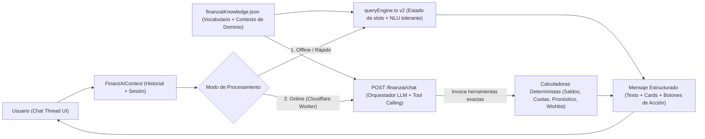

# Plan de Mejora: Evolución de FinanzAI a Chatbot Conversacional

> [!IMPORTANT]
> **Principio Rector (Cero Alucinaciones Numéricas):** En finanzas personales no se debe delegar aritmética a un modelo generativo. Todo cálculo de saldos, cuotas, *Safe-to-Spend*, interés compuesto o viabilidad debe seguir ejecutándose de forma **100% determinista** en el motor matemático (`finance.ts`, `intelligence.ts`, `queryEngine.ts`), mientras la capa conversacional (NLU/LLM) interpreta intención, mantiene contexto entre turnos y redacta respuestas naturales con base en cifras exactas.

---

## 1. Diagnóstico Actual y Brechas vs. un Chatbot Real

| Dimensión | Estado Actual | Brecha UX / Funcional |
| :--- | :--- | :--- |
| **Interacción** | Single-turn (`activeResult` único en `FinanzAIContext.tsx`): cada pregunta borra visualmente la anterior. | No existe hilo de conversación (burbujas usuario / asistente, timestamps, scroll automático). |
| **Memoria** | Sin estado conversacional (`currentQuery` + `activeResult`). | No entiende seguimiento anafórico (*"¿y en 6 cuotas?"*, *"¿y si pago con CMR?"*, *"¿qué pasa si ahorro la mitad?"*). |
| **Comprensión (NLU)** | `classifyQueryIntent` por diccionario secuencial (`normalized.includes(...)`). | Fragilidad ante sinónimos no listados, typos, preguntas compuestas o múltiples entidades a la vez. |
| **Acciones** | `handleAction` en `FinanzAIAssistantModal.tsx` solo cierra el modal y navega a `/(main)/dashboard`. | No puede ejecutar acciones útiles desde el chat (ej. registrar un gasto simulado, añadir una futura compra o marcar un pago). |
| **Privacidad** | `FinanzAIAssistantModal.tsx` lee `isPrivacyEnabled`, pero no enmascara montos ni métricas del resultado. | Si el usuario activa el Modo Camuflaje, FinanzAI sigue mostrando sus saldos reales en pantalla. |

---

## 2. Arquitectura Objetivo (Híbrida: Hilo Conversacional + Base de Conocimiento + Herramientas Deterministas)

### Archivo de Vocabulario y Contexto (`finanzaiKnowledge.json`)

Base de conocimiento declarativa (compartible entre frontend y Cloudflare Worker) que desacopla el lenguaje natural del código matemático de `queryEngine.ts`. Debe contener únicamente conocimiento estático del dominio (sin saldos ni datos personales del usuario):

1. **Vocabulario y Modismos Financieros (Chile / Latam):**
   - Multiplicadores y jerga monetaria (`lucas`, `palos`, `gamba`, `k`, `millón`, `UF`, `sueldo líquido`).
   - Expresiones coloquiales de gasto o liquidez (`quedar pato`, `descalzar`, `carrete`, `gustito`, `pie`, `cuotón`, `cae`).
2. **Diccionario de Sinónimos por Intención y Categoría:**
   - Mapeo ponderado de frases y verbos hacia las intenciones (`what_if_spend`, `safe_to_save`, `card_vs_savings`, `wishlist_evaluation`, etc.).
   - Mapeo de comercios y conceptos chilenos hacia categorías (`alimentacion`: *Lider, Jumbo, PedidosYa, Uber Eats*; `transporte`: *Bip!, Metro, Copec, Tag, Uber*; `servicios`: *Enel, Aguas Andinas, VTR, Entel*).
   - Alias de entidades bancarias e instrumentos locales (`CMR`, `Santander`, `BancoEstado`, `Tenpo`, `Fintual`, `DAP`, `CuentaRUT`).
3. **Disparadores de Continuidad (Follow-ups / Anáforas):**
   - Patrones breves dependientes del turno anterior (*"¿y en cuotas?"*, *"¿y al contado?"*, *"¿y el próximo mes?"*, *"¿y si pago la mitad?"*) junto con el slot que modifican.
4. **Contexto de Dominio FinanzApp (para NLU y System Prompt del LLM):**
   - Glosario oficial de conceptos propios de la app: qué significa **Safe-to-Spend**, **Patrimonio Con/Sin Ahorro**, **Ahorro en Pareja**, **Vigencia Temporal (`end_date`)**, **Futuras Compras Posibles** y **Regla +10% Superávit**.
   - Guía de tono, formato de moneda (`CLP` sin decimales, ej. `$45.000`) y reglas de seguridad (nunca inventar cifras fuera de las herramientas deterministas).

> [!TIP]
> **Regla de Diseño del Archivo de Contexto:** Mantenerlo declarativo y compacto. Para la Fase 3 (LLM), no se debe volcar un archivo extenso en cada petición; basta con inyectar un bloque resumido con el glosario de FinanzApp, las reglas de tono y las definiciones de herramientas, dejando la resolución de sinónimos pesados y alias locales para el parser determinista.

---

## 3. Plan de Implementación por Fases

### Fase 1 — UX de Chatbot Real + Memoria de Turnos (100% Frontend, sin costos de API)
Objetivo: Que la experiencia visual y de interacción se sienta inmediatamente como un chat fluido, conservando respuesta instantánea.

1. **Modelo de Mensajes e Historial (`src/context/FinanzAIContext.tsx`):**
   - Reemplazar `activeResult` único por un arreglo `messages: ChatMessage[]`, donde cada mensaje contiene `id`, `role: 'user' | 'assistant'`, `createdAt`, `text`, y opcionalmente `structuredResult?: QueryEngineResult` (badges de veredicto, tarjetas de métricas, desglose colapsable tipo acordeón y chips de seguimiento).
   - Mantener persistencia de sesión en almacenamiento local (`finanzapp_finanzai_history_v1`, con botón **"Limpiar chat"** / **"Nueva conversación"** en cabecera).
2. **Memoria Conversacional de Contexto (`ConversationSlots`):**
   - Guardar el último contexto activo de la charla: `{ lastIntent, lastAmount, lastHorizon, lastItemName, lastCardId, lastPaymentMode, lastInstallments }`.
   - Soportar **follow-ups reales** sobre el turno previo:
     - Turno 1: *"¿Puedo comprar una tele de 300 lucas?"* → guarda `lastAmount = 300000`, `lastIntent = 'what_if_spend'`.
     - Turno 2: *"¿Y en 6 cuotas?"* / *"¿Y con la Santander?"* / *"¿Y el próximo mes?"* → hereda `lastAmount = 300000` y recalcula con los nuevos parámetros sin exigir repetir toda la pregunta.
3. **Interfaz Tipo Chat (`FinanzAIAssistantModal.tsx`):**
   - Reemplazar la tarjeta única por un `FlatList` / `ScrollView` de burbujas (alineadas a la derecha para el usuario y estilo Obsidian/Glass a la izquierda para FinanzAI, con indicador *"Analizando tus cuentas..."* y auto-scroll al último mensaje).
   - Hacer el **"Desglose Matemático Transparente"** colapsable por defecto (estilo acordeón, consistente con el resto de la app) para no saturar visualmente el chat.
   - Aplicar `isPrivacyEnabled` sobre `verdict`, `recommendation`, `metrics` y `detailedBreakdown` cuando el Modo Camuflaje esté activo.

---

### Fase 2 — NLU Determinista Mejorado + Acciones Ejecutables en el Chat
Objetivo: Que FinanzAI comprenda lenguaje natural flexible y pueda **actuar** (siempre bajo confirmación explícita del usuario).

1. **Externalización de Vocabulario y Parser Multi-Entidad (`src/data/finanzaiKnowledge.json` + `src/lib/queryEngine.ts`):**
   - Mover los arreglos de keywords, modismos chilenos y reglas de categorías actualmente hardcodeados en `queryEngine.ts` hacia `finanzaiKnowledge.json` para ampliar cobertura sin tocar lógica de cálculo.
   - Extraer simultáneamente múltiples entidades en una sola frase: monto, horizonte temporal, nombre de tarjeta (`CMR`, `Santander`), categoría (`delivery`, `supermercado`), modalidad (`contado`, `X cuotas`) e ítem específico de `futurePurchases` (ej. *"¿Me conviene comprar ahora el Mando Nintendo Switch 2?"*).
   - Scoring ponderado + tolerancia a errores tipográficos leves (distancia de Levenshtein / stemming simple de verbos financieros) alimentado por los pesos y sinónimos del archivo de vocabulario, devolviendo aclaración inteligente si la consulta es ambigua en vez de un `fallback` genérico.
2. **Acciones Confirmables ("Action Cards") dentro del Chat:**
   - Permitir que FinanzAI proponga botones accionables con **confirmación previa de 1 toque** dentro de su burbuja:
     - Si preguntas *"¿Puedo gastar 15 lucas en Uber Eats?"* y es viable → botón **"Registrar gasto de $15.000"** (`createVariableExpense`).
     - Si preguntas *"¿Puedo comprar unos audífonos de 80 lucas?"* → botón **"Guardar en Futuras Compras"** (`createFuturePurchase`).
     - Si preguntas *"¿Qué cuentas debo este mes?"* → botones para ir directo a la pestaña correcta en Dashboard (`Tarjetas`, `Gastos Fijos`, `Futuras Compras`) o marcar pagado el ítem pendiente.

---

### Fase 3 — Cerebro Conversacional Híbrido con LLM + Tool-Calling en Backend
Objetivo: Comprensión humana abierta (preguntas complejas, comparaciones libres, explicaciones personalizadas en tono cercano chileno/neutro) sin perder precisión matemática ni exponer API keys en el cliente.

1. **Endpoint Conversacional en Cloudflare Workers (`backend/src/index.ts`):**
   - Crear `POST /finanzai/chat` autenticado con `authenticateRequest`.
   - Persistir sesiones e historial opcionalmente en Cloudflare D1 (nueva tabla `finanzai_messages`) para continuidad entre dispositivos (Web / iOS / Android).
2. **Orquestación Segura (Contexto Resumido + System Prompt + Tool-Calling):**
   - Inyectar en el *System Prompt* el bloque de contexto de dominio proveniente de `finanzaiKnowledge.json` (glosario de FinanzApp, significado de métricas propias, formato CLP y reglas anti-alucinación).
   - Enviar al modelo (Workers AI o API LLM configurada vía `wrangler secret`) únicamente un **snapshot financiero cuantitativo** calculado en el servidor (ingresos, *Safe-to-Spend*, resumen de tarjetas, deudas que vencen, futuras compras y reporte de salud) junto con los últimos `N` turnos de la charla.
   - Definir **herramientas declarativas** (`simulate_spend`, `simulate_purchase_installments`, `project_savings_horizon`, `compare_accounts`, `propose_action`) ejecutadas determinísticamente en código TypeScript para que el LLM redacte la explicación conversacional citando **exclusivamente** números devueltos por las herramientas.
3. **Degradación Elegante (Zero-Downtime Fallback):**
   - Si el backend de IA tarda, no tiene red o supera cuota, el cliente cae automáticamente al motor local de **Fase 1 + Fase 2** (`queryEngine.ts`), garantizando respuesta inmediata 24/7 sin bloquear al usuario.

---

## 4. Impacto y Reglas de Control (`FEATURES.md` / `AGENTS.md`)

Antes de editar código en cualquiera de las fases, se deberán considerar y confirmar las dependencias documentadas en `FEATURES.md`:
- `[feat-finanzai-query-engine]` (`src/lib/queryEngine.ts`)
- `[feat-finanzai-assistant-modal]` (`src/context/FinanzAIContext.tsx`, `src/components/finance/FinanzAIAssistantModal.tsx`)
- `[feat-intelligence-diagnostic-engine]` (`src/lib/intelligence.ts`)
- `[feat-future-purchases-viability]` (si se habilita simulación/creación por nombre desde el chat)
- `[feat-privacy-camouflage-mode]` (si se añade enmascaramiento dentro de las burbujas del chat)
