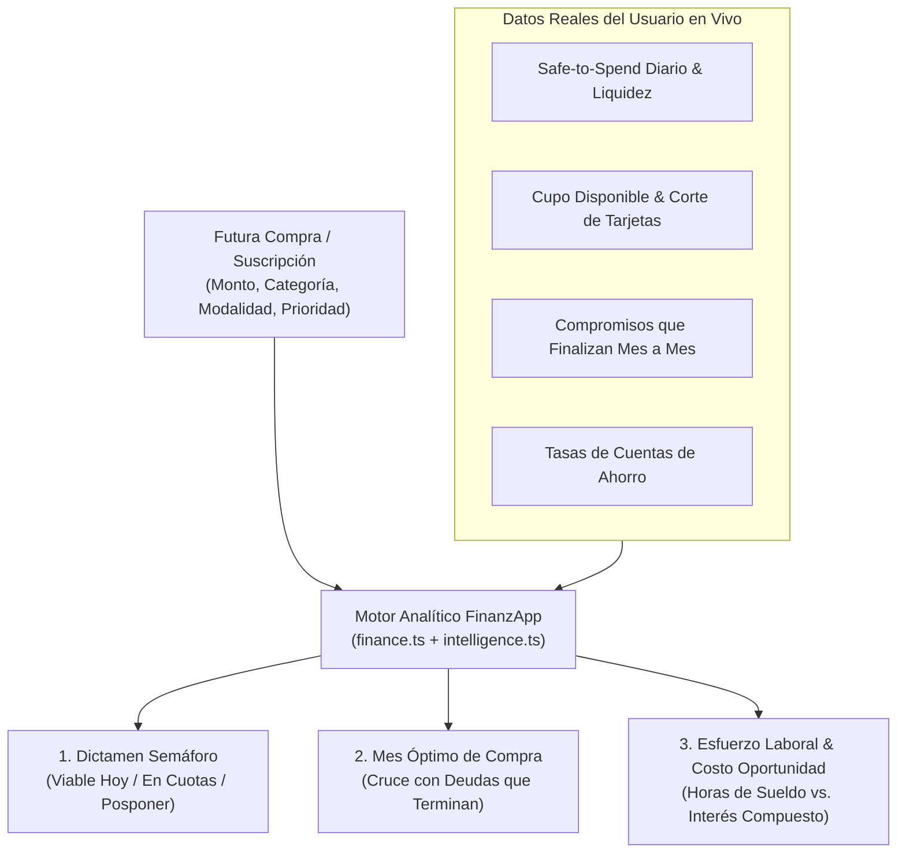

# 🛍️ Plan de Mejora — Módulo de Futuras Compras Posibles & Motor de Viabilidad

> **Planificador Inteligente de Deseos, Proyectos de Compra y Nuevas Suscripciones**  
> **Fecha:** Noviembre 2026  
> **Versión:** 1.0.0  
> **Filosofía de Arquitectura:** 100% Inversión \$0 (Cloudflare D1 + Workers + Expo 52 Universal) · Tesla Minimalist + iOS Liquid Glass

---

## 📑 Tabla de Contenidos

1. [Propósito y Valor Estratégico](#1-propósito-y-valor-estratégico)
2. [Categorías y Tipos de Compras Soportadas](#2-categorías-y-tipos-de-compras-soportadas)
3. [Integración con el Motor Analítico Cuantitativo](#3-integración-con-el-motor-analítico-cuantitativo)
   - [3.1 Semáforo de Viabilidad en Tiempo Real](#31-semáforo-de-viabilidad-en-tiempo-real)
   - [3.2 Cruce con Liberación de Deudas Mes a Mes (Smart Debt-Release Matching)](#32-cruce-con-liberación-de-deudas-mes-a-mes-smart-debt-release-matching)
   - [3.3 Comparador Inteligente: Contado vs. Cuotas vs. Ahorro Previo](#33-comparador-inteligente-contado-vs-cuotas-vs-ahorro-previo)
   - [3.4 Indicadores Anti-Impulso: Horas de Trabajo y Costo de Oportunidad](#34-indicadores-anti-impulso-horas-de-trabajo-y-costo-de-oportunidad)
   - [3.5 Modo Carrito (Simulación Combinada Multi-Ítem)](#35-modo-carrito-simulación-combinada-multi-ítem)
4. [Flujo de Conversión en 1 Toque ("Marcar como Comprado")](#4-flujo-de-conversión-en-1-toque-marcar-como-comprado)
5. [Integración con FinanzAI y Diagnóstico de Salud](#5-integración-con-finanzai-y-diagnóstico-de-salud)
6. [Modelo de Datos (Cloudflare D1) y API Endpoints](#6-modelo-de-datos-cloudflare-d1-y-api-endpoints)
7. [Diseño de Interfaz y Ubicación en la Consola](#7-diseño-de-interfaz-y-ubicación-en-la-consola)
8. [Fases de Implementación](#8-fases-de-implementación)

---

## 1. Propósito y Valor Estratégico

En la gestión financiera personal, la mayor causa de descalce mensual no suelen ser los gastos fijos conocidos, sino las **compras discrecionales no planificadas** (ropa, tecnología, accesorios) y la **acumulación silenciosa de suscripciones**.

Este módulo transforma una simple "lista de deseos" (*wishlist*) en un **Simulador de Viabilidad Cuantitativa** que responde automáticamente:
1. **¿Puedo comprarlo hoy** sin afectar el pago de mis cuentas ni reducir peligrosamente mi presupuesto diario (*Safe-to-Spend*)?
2. **¿Cuál es el mes ideal para comprarlo**, aprovechando los meses en que finalizan créditos o compromisos actuales?
3. **¿Qué medio de pago me conviene más** (débito al contado, tarjeta de crédito en $N$ cuotas sin interés, o ahorrar durante $X$ meses)?
4. **¿Qué impacto permanente tendrá** si se trata de una nueva suscripción mensual?

---

## 2. Categorías y Tipos de Compras Soportadas

Cada ítem registrado cuenta con clasificación visual, nivel de prioridad y modalidad de pago proyectada:

### 2.1 Categorías Predefinidas
| Categoría | Clave | Icono | Ejemplos Cotidianos |
| :--- | :--- | :---: | :--- |
| **👕 Ropa & Calzado** | `ropa` | `Shirt` | Zapatillas, chaqueta, tenida formal, ropa deportiva, accesorios, gafas |
| **⌚ Accesorios & Estilo** | `accesorios` | `Watch` | Reloj, lentes de sol, mochila, perfume, billetera |
| **💻 Tecnología & Gadgets** | `tecnologia` | `Laptop` | Audífonos, celular, monitor, consola, notebook, tablet, Video Juegos |
| **🔄 Suscripción / Membresía** | `suscripcion` | `Repeat` | Streaming, ChatGPT/IA, iCloud, gimnasio, software, club, Nintendo Switch Online |
| **🏠 Hogar & Equipamiento** | `hogar` | `Home` | Cafetera, silla ergonómica, electrodomésticos, decoración |
| **✈️ Viajes & Experiencias** | `experiencias` | `Compass` | Escapada fin de semana, entradas a concierto, curso |
| **📦 Otros Proyectos** | `otros` | `ShoppingBag` | Regalos importantes, equipamiento deportivo, hobbies |

### 2.2 Modalidades de Pago Simulables
1. **Pago Único al Contado (`one_time_cash`):** Evalúa el impacto directo contra el saldo disponible en cuentas corrientes/vista y el margen operativo del mes.
2. **Compra en Cuotas con Tarjeta (`installments`):** Permite definir $N$ cuotas (ej. 3, 6, 12 cuotas). Verifica el **cupo disponible real** en la tarjeta seleccionada (ej. Santander o CMR) y evalúa el peso de la cuota mensual ($\text{Monto} / N$) en los meses futuros.
3. **Suscripción Recurrente Mensual (`recurring_subscription`):** Evalúa la carga mensual perpetua, su costo anualizado ($\text{Monto} \times 12$) y cuánto sube el porcentaje de rigidez fija del usuario.

### 2.3 Niveles de Prioridad
- 🔴 **Alta / Necesidad (`high`):** Reemplazo urgente o herramienta de trabajo/estudio.
- 🟡 **Media / Planificada (`medium`):** Compra deseada que puede esperar el mes óptimo.
- 🔵 **Baja / Capricho (`low`):** Solo ejecutar cuando exista holgura extraordinaria de liquidez.

---

## 3. Integración con el Motor Analítico Cuantitativo



### 3.1 Semáforo de Viabilidad en Tiempo Real
Para cada compra posible, el motor calcula un dictamen instantáneo:
- 🟢 **COMPRA VIABLE HOY (Luz Verde):**
  - El monto cabe dentro del **Ahorro/Margen Seguro Inmediato** (dejando intactos los gastos fijos no pagados y un presupuesto diario saludable $\ge \$8.000\text{/día}$).
- 🟡 **VIABLE CON PLANIFICACIÓN O CUOTAS (Luz Ámbar):**
  - Al contado hoy reduciría demasiado tu liquidez diaria, pero es **viable en cuotas sin interés** (la cuota representa $< 10\%$ de tu flujo libre) o **ahorrando durante $k$ meses**.
- 🔴 **RIESGO DE DESCALCE / POSPONER (Luz Roja):**
  - Comprarlo hoy comprometería el pago de obligaciones fijas, dejaría el flujo libre en negativo o elevaría el uso de cupo de tarjeta sobre el umbral prudente ($> 60\%$).

### 3.2 Cruce con Liberación de Deudas Mes a Mes (*Smart Debt-Release Matching*)
Conectado directamente con el desglose mensual de compromisos que finalizan (`getExpiringExpensesInHorizon`):
- El motor inspecciona qué meses futuros liberan flujo de caja (ej. cuando terminas de pagar un crédito, matrícula o cuota en **Diciembre 2026**, **Enero 2027** o **Abril 2027**).
- **Recomendación Automática de Fecha Ideal:**
  - *Ejemplo:* Si registras un **Monitor / Ropa de \$180.000** o una **Suscripción de \$25.000/mes**, el motor te muestra:
    > 💡 **Ventana Óptima Detectada:** En **Diciembre 2026** dejas de pagar **+\$400.000/mes** (*Chevrolet Sail*, *Polla Familia Manuel*, *Matrícula Udla*). Si programas esta compra para **Enero 2027**, la absorbes con tu flujo recién liberado sin disminuir tu capacidad de ahorro actual.

### 3.3 Comparador Inteligente: Contado vs. Cuotas vs. Ahorro Previo
Dentro de cada tarjeta de futura compra, un desglose compacto compara los 3 caminos matemáticos:
1. **Camino A · Al Contado Hoy:** Nuevo *Safe-to-Spend* diario resultante ($\$/\text{día}$).
2. **Camino B · Tarjeta en $N$ Cuotas (0% interés):** Cuota de $\$X/\text{mes}$, nuevo porcentaje de utilización del cupo de la tarjeta y consejo sobre el **día de corte** (*"Si compras después del día 23 en tu Santander, la 1ª cuota pasa al subsiguiente estado de cuenta"*).
3. **Camino C · Meta de Ahorro Previo:** Cuántos meses necesitas apartar el $10\%$ de tu flujo libre para comprarlo al contado sin tocar tu saldo operativo.

### 3.4 Indicadores Anti-Impulso: Horas de Trabajo y Costo de Oportunidad
Para fomentar compras conscientes:
- **Equivalencia en Esfuerzo Laboral:** Basado en el ingreso mensual fijo del usuario (asumiendo jornada estándar de 180 horas/mes), muestra: *"Equivale a **14,5 horas de tu trabajo** (aprox. 2 días laborales)"*.
- **Costo de Oportunidad en Ahorro Rentable:** Muestra cuánto generaría ese mismo monto depositado durante 12 meses en la cuenta de ahorro de mayor tasa registrada por el usuario (ej. *"En tu cuenta al 5% anual, este monto se convertiría en \$X en 1 año"*).
- **Para Suscripciones:** Muestra siempre el **Costo Anualizado (1 año)** y a **3 años** para evitar el sesgo de "son solo \$9.990 al mes" (\$119.880 al año / \$359.640 en 3 años).

### 3.5 Modo Carrito (Simulación Combinada Multi-Ítem)
- El usuario puede activar un **checkbox de simulación** en varios ítems de su lista (ej. *Zapatillas \$85.000* + *Audífonos \$110.000* + *Suscripción \$12.000/mes*).
- Una **Barra Superior de Simulación Combinada** suma todos los ítems marcados y muestra en vivo:
  - Costo total al contado + cargo mensual adicional.
  - Cómo quedaría el **Flujo de Caja Libre**, el **Presupuesto Diario Seguro** y el **Score de Salud Financiera** si decidiera comprar todos los seleccionados hoy.

---

## 4. Flujo de Conversión en 1 Toque ("Marcar como Comprado")

Cuando el usuario finalmente realiza la compra en la vida real, no tiene que volver a digitarla en otra pestaña:
1. Pulsa el botón **"✅ Lo Compré / Registrar en mis Finanzas"** en la tarjeta del ítem.
2. Según la modalidad elegida, FinanzApp ejecuta automáticamente:
   - **Si fue Al Contado (`one_time_cash`):** Crea automáticamente el gasto en **Gastos Variables (`variable_expenses`)** vinculado a su cuenta de débito, y marca el deseo como `purchased`.
   - **Si fue en Cuotas (`installments`):** Crea automáticamente el compromiso temporal en **Gastos Fijos / Tarjetas (`recurring_items`)** por el valor de la cuota mensual ($\text{Monto}/N$) y fija automáticamente `end_date` en $N$ meses más.
   - **Si fue Suscripción (`recurring_subscription`):** Lo agrega como gasto recurrente mensual activo en la categoría `suscripciones`.

---

## 5. Integración con FinanzAI y Diagnóstico de Salud

1. **Asistente Cuantitativo (`queryEngine.ts` + `FinanzAIAssistantModal.tsx`):**
   - Nueva intención semántica `wishlist_evaluation` y nuevas píldoras rápidas:
     - 🛍️ *"¿Qué de mis futuras compras puedo comprar hoy?"*
     - 📅 *"¿Cuál es mi plan óptimo para comprar mi lista de deseos?"*
   - El asistente lee los ítems guardados en el módulo y entrega un ranking priorizado de qué comprar ahora, qué patear para el mes en que vencen deudas y qué pagar en cuotas.
2. **Motor de Consejos (`intelligence.ts`):**
   - Nueva regla de auditoría: Si el total de suscripciones en "Futuras Compras" sumado a las suscripciones actuales supera el $8\%$ del ingreso, emite una alerta preventiva de **Sobrecarga de Suscripciones**.
   - Si detecta que el usuario tiene un superávit holgado este mes y un ítem de **Prioridad Alta** en su lista, genera un insight positivo (*"Luz Verde: Este mes puedes adquirir [Nombre Ítem] sin afectar tu meta de ahorro"*).

---

## 6. Modelo de Datos (Cloudflare D1) y API Endpoints

### 6.1 Nueva Tabla `future_purchases` en `backend/src/db/schema.sql`
```sql
CREATE TABLE IF NOT EXISTS future_purchases (
  id TEXT PRIMARY KEY,
  user_id TEXT NOT NULL,
  title TEXT NOT NULL,
  category TEXT NOT NULL DEFAULT 'tecnologia', -- 'ropa', 'accesorios', 'tecnologia', 'suscripcion', 'hogar', 'experiencias', 'otros'
  amount INTEGER NOT NULL DEFAULT 0,           -- Precio total (o costo mensual si es suscripción)
  payment_mode TEXT NOT NULL DEFAULT 'one_time_cash' CHECK (payment_mode IN ('one_time_cash', 'installments', 'recurring_subscription')),
  installments_count INTEGER NOT NULL DEFAULT 1,
  target_account_id TEXT,                      -- Cuenta vista o tarjeta de crédito preferida
  priority TEXT NOT NULL DEFAULT 'medium' CHECK (priority IN ('high', 'medium', 'low')),
  target_period TEXT,                          -- Mes objetivo opcional (YYYY-MM)
  status TEXT NOT NULL DEFAULT 'evaluating' CHECK (status IN ('evaluating', 'planned', 'purchased')),
  notes TEXT,
  created_at TEXT NOT NULL DEFAULT (datetime('now')),
  updated_at TEXT NOT NULL DEFAULT (datetime('now')),
  FOREIGN KEY (user_id) REFERENCES users(id) ON DELETE CASCADE,
  FOREIGN KEY (target_account_id) REFERENCES accounts(id) ON DELETE SET NULL
);

CREATE INDEX IF NOT EXISTS idx_future_purchases_user_id ON future_purchases(user_id);
CREATE INDEX IF NOT EXISTS idx_future_purchases_status ON future_purchases(user_id, status);
```

### 6.2 Endpoints REST en `backend/src/index.ts` (con Respaldo Local Automático)
- `GET /future-purchases` — Lista todas las futuras compras del usuario.
- `POST /future-purchases` — Crea un nuevo ítem de compra futura o suscripción.
- `PUT /future-purchases/:id` — Edita monto, cuotas, prioridad, cuenta o estado.
- `DELETE /future-purchases/:id` — Elimina el ítem de la lista.
- *Resiliencia:* Al igual que con los demás módulos, `src/lib/api.ts` contará con caché y respaldo local (`localStorage` / `SecureStore`) para que funcione instantáneamente incluso si el backend remoto aún no ha sido redesplegado.

---

## 7. Diseño de Interfaz y Ubicación en la Consola

Siguiendo la estética **Tesla Minimalist + iOS Liquid Glass**:

1. **Nueva Pestaña en el Dashboard (`Compras Futuras` / `Deseos`):**
   - Ubicada en la barra de módulos del Dashboard (`Resumen | Billetera | Fijos | Tarjetas | Ahorro | 🛍️ Compras Futuras`).
2. **Cabecera Ejecutiva de Capacidad de Compra:**
   - **Tarjeta 1:** *Presupuesto Seguro para Compras Hoy* (lo que puedes destinar hoy sin tocar cuentas fijas ni tu colchón diario).
   - **Tarjeta 2:** *Próximo Impulso de Liquidez* (el mes más cercano donde vencen deudas y cuánto flujo mensual libre se desbloquea).
   - **Tarjeta 3:** *Simulador de Carrito Activo* (impacto combinado de los ítems seleccionados).
3. **Catálogo Rápido de Plantillas (1 Toque):**
   - Chips rápidos para pre-llenar el formulario en 1 segundo: `👕 Ropa / Calzado`, `⌚ Accesorio`, `💻 Tecnología`, `🔄 Nueva Suscripción`, `🏠 Hogar`, `✈️ Viaje / Experiencia`.
4. **Tarjetas Inteligentes por Ítem (`FuturePurchaseCard`):**
   - Badge de categoría + Prioridad + Semáforo de viabilidad (`VIABLE HOY`, `MEJOR EN ENE 2027`, `EN 6 CUOTAS`).
   - Selector interactivo rápido en la misma tarjeta para alternar entre **Contado** vs. **3 / 6 / 12 Cuotas** y ver cómo cambia el dictamen al instante.
   - Botón **"✅ Marcar como Comprado"** que convierte el deseo en un movimiento real.

---

## 8. Fases de Implementación

| Fase | Alcance | Archivos Principales |
| :--- | :--- | :--- |
| **Fase 1: Base de Datos y API Resiliente** | Tabla `future_purchases` en D1, endpoints CRUD en Hono Worker y cliente con fallback local automático. | `backend/src/db/schema.sql`, `backend/src/index.ts`, `src/lib/api.ts` |
| **Fase 2: Motor Cuantitativo de Viabilidad** | Funciones de evaluación de compras (contado, cuotas, suscripción), cruce con liberación de deudas mes a mes, cálculo de horas laborales y costo de oportunidad. | `src/lib/finance.ts`, `src/lib/intelligence.ts` |
| **Fase 3: Interfaz del Módulo `FuturePurchasesSection`** | Componente interactivo Liquid Glass con filtros por categoría, simulador de carrito multi-ítem, comparador contado/cuotas y conversión en 1 clic a gasto real. | `src/components/finance/FuturePurchasesSection.tsx`, `src/app/(main)/dashboard.tsx` |
| **Fase 4: Integración con FinanzAI** | Nuevas consultas y píldoras rápidas en el asistente para auditar y priorizar la lista de futuras compras. | `src/lib/queryEngine.ts`, `src/components/finance/FinanzAIAssistantModal.tsx` |
