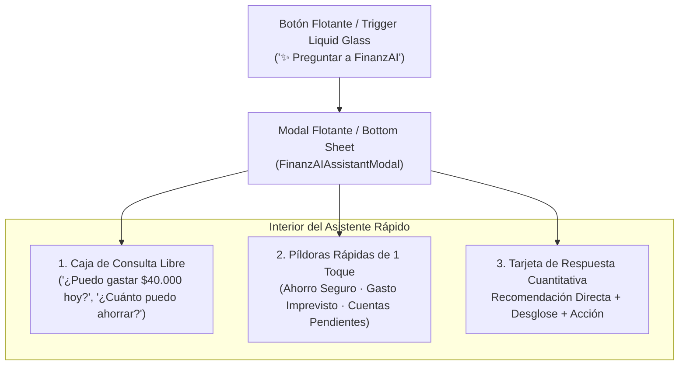
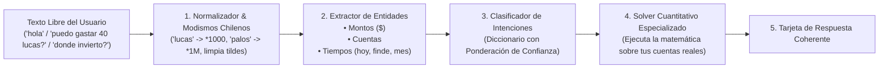
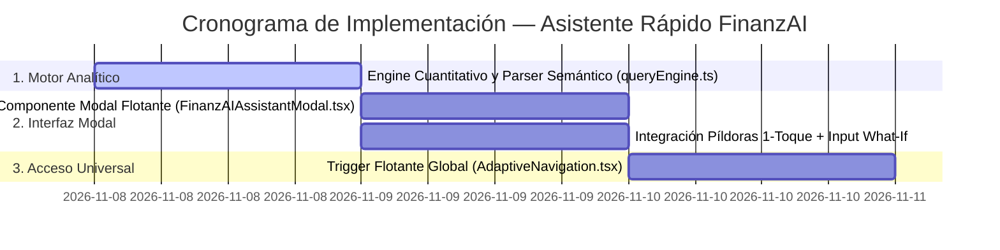

# 🧠 Plan de Ejecución — Asistente Rápido Financiero (FinanzAI Q&A)

> **Modal Flotante Universal & Consultor Cuantitativo en Tiempo Real**  
> **Modalidad:** Modal Flotante ("Asistente Rápido") disponible desde cualquier pantalla  
> **Alcance v1:** Píldoras de 1 Toque + Caja de Consulta Libre (*What-If Engine*)  
> **Arquitectura:** Motor Cuantitativo Determinista Local · 100% Inversión $0 · Tesla Minimalist + iOS Liquid Glass

---

## 📑 Tabla de Contenidos

1. [Resumen de Decisiones de Diseño](#1-resumen-de-decisiones-de-diseño)
2. [Arquitectura de Navegación y Acceso Universal](#2-arquitectura-de-navegación-y-acceso-universal)
3. [Componente Modal: Estructura del Asistente Rápido](#3-componente-modal-estructura-del-asistente-rápido)
4. [Catálogo Integrado de Píldoras de 1 Toque](#4-catálogo-integrado-de-píldoras-de-1-toque)
5. [Motor Semántico y Diccionario de Vocabulario (What-If Engine)](#5-motor-semántico-y-diccionario-de-vocabulario-what-if-engine)
   - [5.1 Pipeline de Procesamiento Paso a Paso](#51-pipeline-de-procesamiento-paso-a-paso)
   - [5.2 Taxonomía de Intenciones y Vocabulario Completo](#52-taxonomía-de-intenciones-y-vocabulario-completo)
   - [5.3 Manejo de Casos Extremos (Saludos, Consultas Extensas y Fallbacks)](#53-manejo-de-casos-extremos-saludos-consultas-extensas-y-fallbacks)
6. [Diseño de Respuestas Estructuradas](#6-diseño-de-respuestas-estructuradas)
7. [Compatibilidad con Modo Privado (Camouflage Mode)](#7-compatibilidad-con-modo-privado-camouflage-mode)
8. [Cronograma y Fases de Implementación](#8-cronograma-y-fases-de-implementación)

---

## 1. Resumen de Decisiones de Diseño

Siguiendo tus indicaciones, la sección de preguntas se estructura bajo los siguientes pilares:

* **Modal Flotante Universal (Opción B):** No requiere cambiar de pestaña ni perder el contexto de lo que se está haciendo. Un botón flotante / trigger Liquid Glass permite invocar al asistente desde el Dashboard, la Billetera, Tarjetas, Gastos Fijos, Consejos o Perfil.
* **Entrega Completa en v1 (Ambas Juntas):**
  1. **Catálogo de Píldoras de 1 Toque:** Respuestas automáticas inmediatas a las preguntas más críticas (ej. cuánto puedo ahorrar hoy, si llego a fin de mes, ritmo diario).
  2. **Caja de Entrada Libre (*What-If Engine*):** El usuario puede tipear cualquier pregunta con montos libres (ej. *"¿puedo gastar 45 mil este viernes?"*, *"¿en qué cuenta me recomiendas invertir?"*, *"hola"*).
* **Precisión Matemática 100% Determinista:** Alimentado por `src/lib/finance.ts` e `intelligence.ts`. Sin alucinaciones de IA genéricas: cálculos exactos en CLP sobre los saldos bancarios y compromisos reales.
* **Cero Costo de Servidores ($0):** Todo el cómputo se ejecuta en el dispositivo de forma síncrona (0 ms de latencia, compatible offline).

---

## 2. Arquitectura de Navegación y Acceso Universal



### Ubicación del Trigger de Apertura
* **En Móvil (Web / Android / iOS):**
  - Botón flotante Liquid Glass (FAB) en la esquina inferior derecha o píldora destacada en la cabecera.
* **En Escritorio (Desktop Console):**
  - Botón interactivo en el sidebar de navegación: *"Asistente Cuantitativo"* con atajo de teclado opcional (`Cmd + K` / `Ctrl + K`).

---

## 3. Componente Modal: Estructura del Asistente Rápido

El modal utilizará el diseño **iOS Liquid Glass + Tesla Minimalist**:
* **Fondo:** Translúcido con desenfoque de cristal (`BlurView` intensidad 65, tinte oscuro, borde `rgba(255, 255, 255, 0.12)`).
* **Cabecera:** 
  - Título: *"FinanzAI · Asistente Cuantitativo"*.
  - Badge de estado: *"Sincronizado con tus saldos en vivo"*.
  - Botón de cierre `X` en píldora.
* **Cuerpo Desplazable:**
  - Caja de texto interactiva superior con autocompletado y botón de envío *"Consultar"*.
  - Sección *"Preguntas Frecuentes Rápidas (1 Toque)"* dispuestas en chips deslizables.
  - Tarjeta de respuesta expandible con desglose visual y botones de acción.

---

## 4. Catálogo Integrado de Píldoras de 1 Toque

| Píldora de 1 Toque | Algoritmo y Fórmula del Motor | Salida Generada |
| :--- | :--- | :--- |
| 💰 **"¿Cuánto puedo ahorrar hoy de mi saldo?"** | $\text{Saldo Bancos} - \text{Fijos No Pagados} - (\text{Días} \times \text{Diario}) - \text{Colchón 15\%}$ | Monto exacto en CLP sugerido para transferir a ahorro sin descalzar el mes. |
| 🛍️ **"¿Puedo gastar \$50.000 sin descalzarme?"** | Simula $\text{Nuevo Safe-to-Spend} = \frac{\text{Margen} - 50.000}{\text{Días}}$ | Dictamen: *"Aprobado (zona verde)"* o *"Alerta: tu presupuesto diario bajará a \$X/día"*. |
| 📅 **"¿Cuánto puedo gastar por día hasta fin de mes?"** | $\text{Safe-to-Spend} = \frac{\max(0, \text{Margen Libre})}{\text{Días Restantes}}$ | Cifra diaria en CLP y semáforo de holgura. |
| 💳 **"¿Qué pagos obligatorios me faltan este mes?"** | Filtro de recurrentes con `is_paid = false` + facturación de tarjeta | Lista consolidada con fecha y monto total a reservar. |
| 🛡️ **"¿Cuántos meses cubren mis ahorros hoy?"** | $\frac{\text{Ahorro Líquido Acumulado}}{\text{Costo de Vida Fijo Mensual}}$ | Ratio de supervivencia (ej. *2.8 meses*) y brecha para llegar a 3 o 6 meses. |
| 📉 **"¿En qué categoría se fue más dinero este mes?"** | Ranking agrupado de gastos variables por categoría | Categoría líder (ej. *Delivery 42%* o *Supermercado 35%*) y consejo de ajuste. |

---

## 5. Motor Semántico y Diccionario de Vocabulario (What-If Engine)

Para que el asistente nunca responda cosas incoherentes o se quede "en blanco", el motor analítico implementa una arquitectura de **3 capas**: Normalización $\rightarrow$ Extracción de Entidades $\rightarrow$ Clasificación por Diccionario Ponderado.



---

### 5.1 Pipeline de Procesamiento Paso a Paso

1. **Normalización Inteligente de Modismos Chilenos:**
   * Traduce expresiones coloquiales antes de procesar:
     * `"lucas"`, `"luca"`, `"k"`, `"mil"` $\rightarrow$ Multiplicador $\times 1.000$ (ej: *"40 lucas"* $\rightarrow$ `$40.000`).
     * `"palos"`, `"palo"`, `"millón"`, `"millones"`, `"m"` $\rightarrow$ Multiplicador $\times 1.000.000$ (ej: *"1.5 palos"* $\rightarrow$ `$1.500.000`).
     * Limpieza de tildes y signos (`"¿dónde invierto?"` $\rightarrow$ `"donde invierto"`).
2. **Extracción de Entidades:**
   * **Monto:** Extrae cualquier valor numérico explícito (`$50.000`, `25000`, `100k`).
   * **Horizonte Temporal:** `hoy`, `este fin de semana`, `este mes`, `fin de mes`, `este año`.
   * **Cuenta Objetivo:** `cuenta corriente`, `santander`, `cmr`, `falabella`, `ahorro`, `billetera`.

---

### 5.2 Taxonomía de Intenciones y Vocabulario Completo

El motor cuenta con un diccionario semántico categorizado en **8 intenciones fundamentales**:

#### Intención 1: Saludo, Onboarding y Ayuda General
* **Vocabulario Clave:**
  `hola`, `buenas`, `buenos dias`, `buenas tardes`, `que haces`, `como funciona`, `ayuda`, `quien eres`, `menu`, `comandos`, `empezar`, `inicio`.
* **Comportamiento del Motor:**
  * No inventa números. Saluda cordialmente y presenta de forma ejecutiva sus 3 funciones estrella:
    1. Calcular cuánto puedes ahorrar hoy de tu saldo bancario.
    2. Simular si puedes hacer una compra o gasto imprevisto sin descalzarte.
    3. Recomendar en qué cuenta de ahorro te conviene abonar según tus tasas.
  * Adjunta 3 botones de acción inmediata para que el usuario elija con un toque.

---

#### Intención 2: Recomendación de Inversión y Cuentas de Ahorro
* **Vocabulario Clave:**
  `en que cuenta invertir`, `donde me conviene meter la plata`, `cual cuenta da mas interes`, `donde ahorrar`, `invertir`, `inversion`, `rentabilidad`, `tasa`, `mejor cuenta`, `consorcio`, `banco estado`, `bancoestado`, `fintual`, `tenpo`, `dap`, `deposito a plazo`, `cuenta de ahorro`, `rendimiento`.
* **Comportamiento del Motor:**
  * Lee la lista de cuentas de ahorro (`type === 'savings'`) registradas por el usuario en la app.
  * Analiza la tasa de interés anual configurada (`annualRate`, ej. 5.5% vs 3.2%).
  * Evalúa si tiene cuentas en pareja o metas fijas.
  * **Respuesta Cuantitativa:** Nombra con exactitud la cuenta que ofrece el mayor rendimiento compuesto anual libre de riesgo, calcula cuánto ganaría al año por cada \$100.000 depositados, y le recuerda la regla del 10% de superávit.

---

#### Intención 3: Tarjetas de Crédito vs. Ahorro (Criterio de Pre-Pago)
* **Vocabulario Clave:**
  `me conviene pagar la tarjeta o ahorrar`, `pago la tarjeta o ahorro`, `liquidar tarjeta`, `prepagar cuotas`, `intereses tarjeta`, `debo la tarjeta`, `conviene pagar cuotas`, `pagar el minimo`.
* **Comportamiento del Motor:**
  * Compara el costo financiero anual de la deuda en tarjeta (tasa rotativa ~25% a 35% anual en Chile) contra la tasa de ahorro (~4% a 6% anual).
  * **Regla Financiera Profesional:** Si la tarjeta tiene saldo rotativo o cuotas con interés, la rentabilidad matemática de liquidar la deuda equivale a una ganancia garantizada del 25%+, superando cualquier instrumento de ahorro tradicional.
  * **Respuesta:** Le indica exactamente cuánto debe abonar a su tarjeta (ej. Santander o CMR) antes de transferir a ahorro.

---

#### Intención 4: Ahorro Seguro Inmediato (De mi saldo en billetera)
* **Vocabulario Clave:**
  `cuanto puedo ahorrar hoy`, `cuanto guardo`, `meter a cuenta de ahorro`, `cuanto paso al ahorro`, `cuanto me recomiendas ahorrar`, `dejar para fin de mes`, `cuanto puedo transferir`.
* **Comportamiento del Motor:**
  * Aplica la fórmula de Ahorro Seguro Inmediato:
    $$\text{Ahorro Seguro} = \text{Saldo Cuentas Vista} - \text{Fijos No Pagados} - (\text{Días Restantes} \times \text{Gasto Diario Base}) - \text{Colchón 15\%}$$
  * Genera el desglose con el monto exacto para transferir hoy, el remanente de tranquilidad para fin de mes y el botón para simular el depósito.

---

#### Intención 5: Simulación de Compra / Gasto Imprevisto (*What-If Spend*)
* **Vocabulario Clave:**
  `puedo gastar`, `me alcanza para`, `puedo comprar`, `comprar`, `gastar`, `salir`, `cena`, `viaje`, `carrete`, `asado`, `zapatillas`, `gustito`, `salida`, `escapada` + *(Monto en CLP)*.
* **Comportamiento del Motor:**
  * Extrae el monto ingresado (ej. `$40.000`).
  * Simula el descuento en la liquidez disponible y recalcula el nuevo *Safe-to-Spend* diario para los días que le quedan al mes.
  * **Dictamen:**
    * Si el nuevo ritmo diario queda sobre el umbral seguro: *"✅ Compra Viable. Tu ritmo diario pasará de \$16.000 a \$14.200/día (sigue en rango verde)"*.
    * Si el ritmo diario cae en zona roja: *"⚠️ Ajuste Necesario. Esta compra reduciría tu presupuesto diario a \$4.100/día, poniendo en riesgo el pago de tus cuentas de fin de mes"*.

---

#### Intención 6: Diagnóstico de Supervivencia y Salud Financiera
* **Vocabulario Clave:**
  `como voy`, `como estan mis finanzas`, `llego a fin de mes`, `cuantos meses sobrevivo`, `fondo de emergencia`, `score de salud`, `tengo suficiente plata`, `estado financiero`.
* **Comportamiento del Motor:**
  * Extrae el Score de Salud (ej. `70/100`), la Rigidez Fija (`64%`) y los meses de cobertura del fondo de emergencia (`2.5 meses`).
  * Le indica en un párrafo directo cuál es su fortaleza principal y su principal punto de fuga actual.

---

#### Intención 7: Radar de Cuentas y Cuotas por Pagar
* **Vocabulario Clave:**
  `que cuentas me faltan pagar`, `que debo este mes`, `cuentas pendientes`, `cuanto debo en la tarjeta`, `cuando vence la tarjeta`, `gastos fijos pendientes`, `compromisos del mes`.
* **Comportamiento del Motor:**
  * Filtra los gastos fijos del período donde `is_paid = false`.
  * Suma la facturación mensual de tarjetas de crédito.
  * Despliega la lista detallada con los montos y fechas para que el usuario no sufra cortes de servicio ni intereses por mora.

---

### 5.3 Manejo de Casos Extremos (Saludos, Consultas Extensas y Fallbacks)

| Escenario de Entrada | Ejemplo del Usuario | Estrategia de Respuesta |
| :--- | :--- | :--- |
| **Solo Saludo / Corto** | `"hola"`, `"buenas"`, `"hey"` | Respuesta cordial ejecutiva + presentación de sus capacidades analíticas + 3 píldoras interactivas de inicio. |
| **Consulta Extensa Compleja** | `"Hola tengo 800 mil en mi cuenta santander pero no se si pagar la cmr o meter 300 lucas a la cuenta de consorcio para que me de intereses que me recomiendas?"` | El extractor detecta múltiples intenciones: <br>1. Analiza el saldo de la cuenta (\$800k).<br>2. Evalúa la deuda de la tarjeta CMR.<br>3. Evalúa la tasa de la cuenta de ahorro Consorcio.<br>Entrega una respuesta jerarquizada priorizando la deuda cara antes de abonar al ahorro. |
| **Monto sin Verbo** | `"$70.000"` o `"50 lucas"` | Detecta la cifra y pregunta: *"¿Deseas simular si puedes gastar $70.000 hoy o prefieres calcular cuánto ahorrar?"* con 2 botones de 1 toque. |
| **Pregunta Fuera de Dominio** | `"¿quién ganó el partido de ayer?"` o `"receta de pizza"` | **Fallback Educado:** *"Soy tu consultor financiero cuantitativo en FinanzApp. Puedo ayudarte a optimizar tus ahorros, simular gastos, auditar tarjetas o proyectar tu fin de mes. ¿Te gustaría consultar alguna de estas opciones?"* + 3 opciones financieras. |

---

## 6. Diseño de Respuestas Estructuradas

Cada respuesta dentro del modal se estructura en un contenedor Liquid Glass de 3 niveles:

```
┌────────────────────────────────────────────────────────────────────────┐
│ 💡 RECOMENDACIÓN CUANTITATIVA                                          │
│                                                                        │
│ Te recomendamos transferir hoy a tu ahorro: $1.100.000                │
│                                                                        │
│ Dejarás $750.000 en tu cuenta corriente para operar con tranquilidad: │
│                                                                        │
│ • Cuentas pendientes aseguradas:             -$430.000                │
│ • Consumo diario holgado ($12.000/día):       -$276.000 (23 días)      │
│ • Colchón de seguridad ante emergencias:      -$44.000                 │
│                                                                        │
│ [ 🚀 Simular Transferencia a Mi Ahorro ]  [ ✏️ Modificar Monto ]       │
└────────────────────────────────────────────────────────────────────────┘
```

---

## 7. Compatibilidad con Modo Privado (Camouflage Mode)

* Conectado síncronamente al hook `usePrivacy()`:
  * Si el usuario está en el metro o micro con el **Modo Privado ACTIVO**:
    - Todos los números monetarios dentro de la respuesta se muestran como **`$ ••••••`**.
    - Los porcentajes (ej. *5.5% anual*, *64% de rigidez*), la cantidad de días y los diagnósticos cualitativos permanecen legibles.
  * Si el **Modo Privado está INACTIVO**:
    - Las cifras se presentan en formato completo en CLP (ej. `$1.100.000`).

---

## 8. Cronograma y Fases de Implementación



### Entregables Concretos:
1. `src/lib/queryEngine.ts`: Normalizador de modismos chilenos, extractor de entidades, diccionario ponderado y solvers matemáticos deterministas.
2. `src/components/finance/FinanzAIAssistantModal.tsx`: Modal Liquid Glass universal con input de texto libre, catálogo de píldoras de 1 toque y tarjetas de respuesta interactiva.
3. `src/components/ui/FinanzAITriggerButton.tsx`: Botón flotante accesible desde cualquier pantalla.
4. Integración en `src/components/layout/AdaptiveNavigation.tsx` para acceso global en escritorio y móvil.
